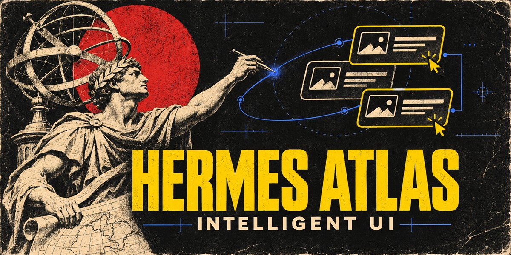
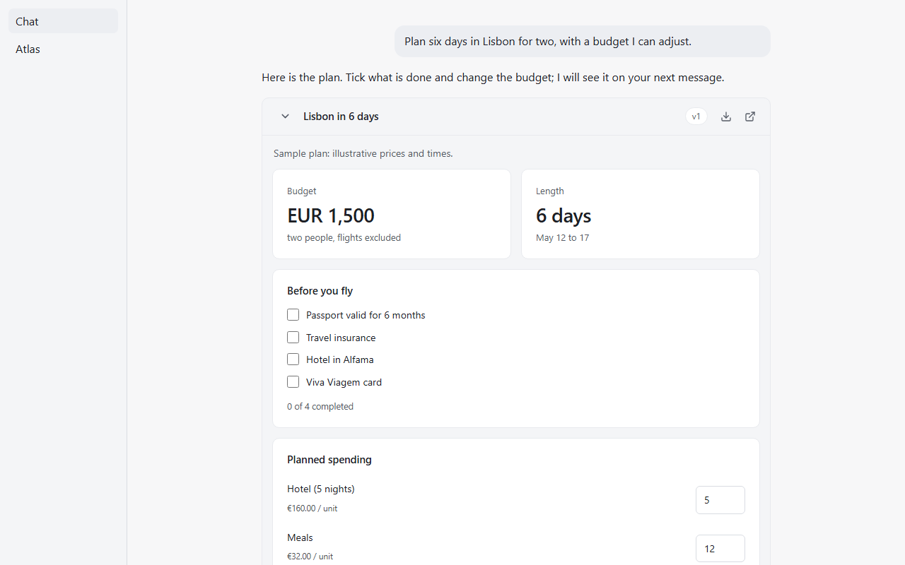
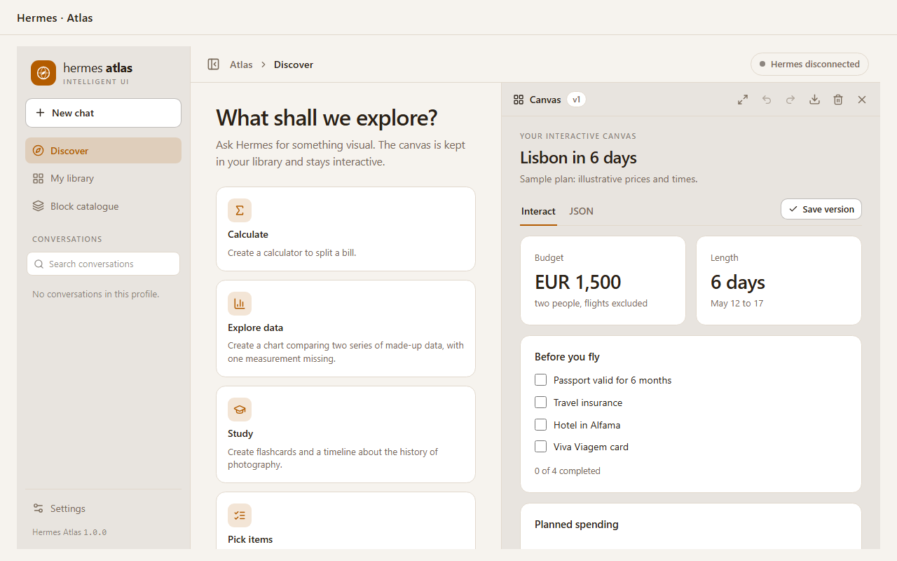

# Hermes Atlas · Intelligent UI

[](https://github.com/sesantanajr/hermes-atlas-intelligent-ui/actions/workflows/ci.yml)


[Português](README.md)

**Interactive canvases for [Hermes Agent](https://github.com/NousResearch/hermes-agent).** Ask
for a comparison, a plan, a budget or a dashboard, and the agent answers with a canvas you can
tick, filter, adjust and fill in: right in the conversation in Hermes Desktop, in a tab of the
web dashboard, or as an HTML page. On your next message, the agent already knows what you changed.



**Version 1.0.0**: a complete rebuild for the current Hermes Agent plugin contract.
[What changed](CHANGELOG.md) · [Upgrading from 0.6](docs/MIGRATION.md)

## Highlights

- **73 block types** in eight categories: charts, filterable tables, forms, checklists, maps,
  routes, kanban boards, calculators, quizzes, flashcards, budgets and more. Everything is
  validated, declarative JSON: the model writes no HTML or JavaScript.
- **A real loop with the agent.** What you do on a canvas becomes a draft the agent reads with
  `atlas_get`, and Hermes tells it, once, when you change a canvas it made. To change one part,
  the agent edits just that part (`atlas_update`) instead of resending the canvas.
- **Native on every Hermes surface**: a live canvas in Desktop and Webapp conversations, a
  dashboard tab, a text summary in terminals and messaging apps, and the interactive page as an
  attachment when you ask for it.
- **Light**: nothing to install besides the plugin, no Python or Node dependencies. `register()`
  adds about 19 ms to Hermes's start; 0.6 took about 650 ms ([measurements](docs/benchmark.json)).
- **Safe by design**: canvas actions only draft messages you review, the exported page makes no
  network requests, and credentials stay on the server. [Details](docs/SECURITY.md)
- **English and Portuguese**, following Hermes's language, and the colours of the Hermes theme,
  light, dark or custom.

## Install

Requires **Hermes Agent 0.21.0** or later. No Node or extra Python packages: the interface
bundles ship in the repository.

```sh
hermes plugins install sesantanajr/hermes-atlas-intelligent-ui --enable
```

Without `--enable`, Hermes installs the plugin switched off; turn it on with
`hermes plugins enable hermes-atlas`.

- **Hermes Desktop and Webapp**: in **Capabilities → Plugins**, Hermes Atlas is one row with two
  switches. **Agent** turns on the tools, the `/atlas` command and the skill; **Desktop** turns on
  the canvas in conversations and the **Atlas** page in the sidebar. Turn on both. You can also
  install from there: **Capabilities → Plugins → Install** with
  `sesantanajr/hermes-atlas-intelligent-ui`.
- **Web dashboard**: the **Atlas** tab appears when the dashboard reloads. If your version does not
  reload plugins by itself, restart `hermes dashboard`.
- **Explicit toolset list**: if your configuration uses one, add `atlas`.

Check, update and remove:

```sh
hermes plugins doctor hermes-atlas
hermes atlas doctor
hermes plugins update hermes-atlas
hermes plugins remove hermes-atlas   # the library in plugin-data/hermes-atlas is kept
```

## Use

Ask the way you would ask a person:

- “Compare three laptops under $1,200 in a canvas, with a table and a score for each.”
- “Build a travel budget for Lisbon that I can adjust.”
- “Make flashcards and a quiz about the French Revolution.”
- “Turn this CSV into a monthly line chart.” (with the file attached)

The `hermes-atlas:canvas` skill teaches the agent when a canvas helps, which blocks to use and how
to update them. How the canvas is shown depends on where you are talking:

| Where you talk | What you get |
| --- | --- |
| **Hermes Desktop / Webapp** with the extension on | The live canvas inside the reply. Tick, adjust and fill it in there; canvas buttons put text in your message box and never send on their own. |
| Hermes Desktop without the extension | A card with the canvas's interactive page, which opens in the preview. |
| **Web dashboard** | The **Atlas** tab: library, block catalogue and its own chat with Hermes. |
| Terminal (CLI and TUI) | A text summary. `/atlas show <id>` prints the whole canvas as Markdown. |
| Telegram, Discord, WhatsApp and others | A text summary. Ask “send me the canvas” and the agent attaches the HTML page. |



### Commands

In any conversation:

```text
/atlas                                  summary and recent canvases
/atlas list [text]                      search by title
/atlas show <id or title> [revision]    read the canvas as text
/atlas export <id or title> [html|md|json]
```

In a terminal: `hermes atlas status`, `list`, `show`, `export`, `doctor` and `serve`. The last one
opens Atlas as a standalone app on `http://127.0.0.1:7331`, with no login of its own and on
loopback only.

## Configure

```sh
hermes plugins config hermes-atlas
```

| Setting | Default | What it does |
| --- | --- | --- |
| `reply_style` | `auto` | How a canvas enters a reply. `auto` picks by surface (table above); `file` always attaches the interactive page; `directive` always uses the `::atlas{…}` line; `text` never shows the canvas in the conversation. |
| `context_hints` | `true` | Tell the agent, once, when you change a canvas it made. |
| `resources_tool` | `true` | Offer `atlas_resources` (disk, memory and load of the Hermes machine). |
| `locale` | `auto` | Language of `/atlas`, `hermes atlas` and exports: `auto` (Hermes's), `pt-BR` or `en`. |

The Atlas chat of its own (dashboard and standalone app) uses the Hermes API server. Enable it in
the profile with `API_SERVER_ENABLED=true` and `API_SERVER_KEY`; the default address is
`http://127.0.0.1:8642/v1`, and secondary profiles use `/p/<profile>/v1`. Canvases, the library,
the tools and the canvas in Desktop conversations work without it.

## Agent tools

| Tool | What for |
| --- | --- |
| `atlas_components` | Lists the 73 block types, or returns the schema and an example of the types asked for. |
| `atlas_render` | Creates a canvas, validates and saves it in the library, and tells the model how to show it on that surface. |
| `atlas_update` | Changes parts of a canvas (add, replace, remove, move blocks; title, sources, state). |
| `atlas_get` | Reads a canvas with the user's current state, in full, as an outline or as text. |
| `atlas_list` | Searches the library by title. |
| `atlas_export` | Writes the canvas as an interactive HTML page, Markdown or JSON and returns the `MEDIA:` line to attach it. |
| `atlas_resources` | Measures disk, memory, swap and load of the Hermes machine, read-only. |

Parameters, results and examples: [docs/TOOLS.md](docs/TOOLS.md).

## Your data

Everything lives in `<HERMES_HOME>/plugin-data/hermes-atlas/`: the library (`atlas.db`, SQLite,
with every revision of every canvas, the Atlas chat's conversations and drafts) and the exports
(`exports/`, the 60 most recent). Each Hermes profile has its own. Nothing goes to third parties:
Atlas only talks to Hermes itself. Back that folder up as you would the rest of the profile.

## Documentation

- [Architecture](docs/ARCHITECTURE.md): how the pieces fit into Hermes.
- [Compatibility](docs/COMPATIBILITY.md): what Atlas uses from Hermes, since which version, and how it was verified.
- [Tools](docs/TOOLS.md) · [Security](docs/SECURITY.md) · [Upgrading from 0.6](docs/MIGRATION.md)
- [Development](docs/DEVELOPMENT.md): build, test and look at the three hosts in a browser.
- [Release history](CHANGELOG.md)

The documents under `docs/` are written in Portuguese, the project's working language.

## Licence

[MIT](LICENSE) © 2026 sesantanajr. Hermes Agent is a Nous Research project; Atlas is a community
plugin with no official affiliation.
