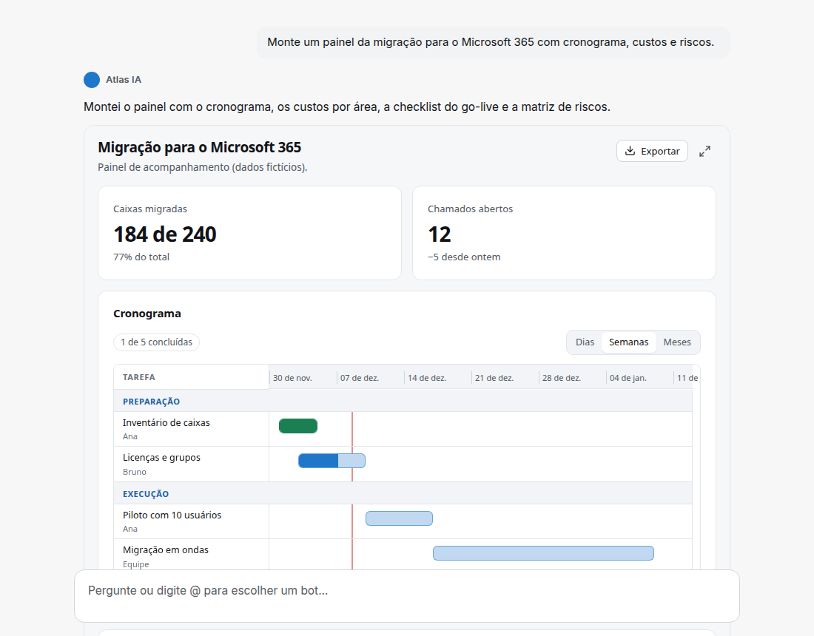
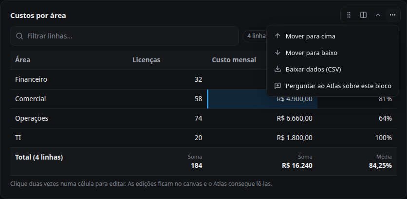
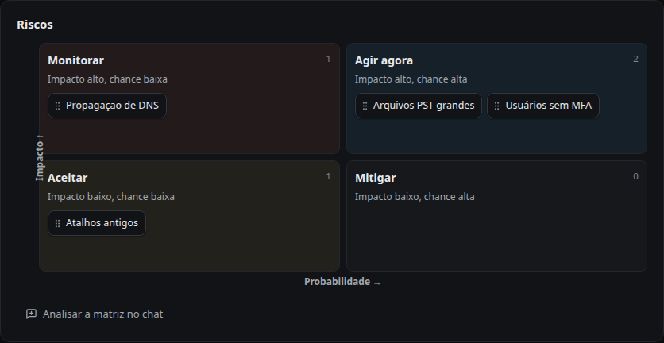
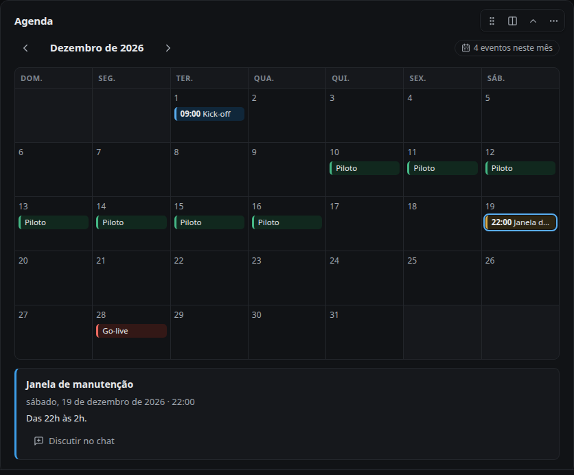
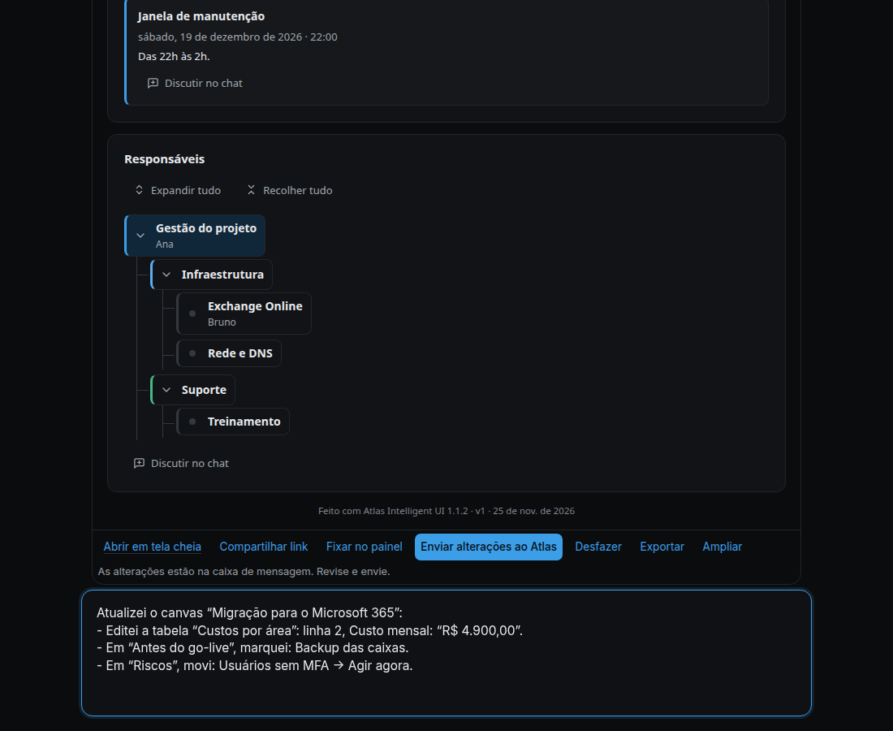

# Atlas Intelligent UI

[](https://github.com/sesantanajr/hermes-atlas-intelligent-ui/actions/workflows/ci.yml)


[Português](README.md)

**Interactive canvases for [Hermes Agent](https://github.com/NousResearch/hermes-agent).** Ask for
a dashboard, a schedule, a comparison or a budget, and the agent answers with a canvas you tick,
edit, rearrange, filter and export: inside the conversation in Hermes Desktop, in the Webapp, in a
dashboard tab, in any chat app that frames the canvas page (such as the Atlas portal) or as an HTML
page. On your next message, the agent already knows what you changed.


**Version 1.1.2**: a live canvas in any conversation that frames it, editable tables, draggable
blocks, PNG, PDF, CSV and HTML export, four planning blocks (Gantt chart, calendar, priority matrix
and tree), the Atlas light and dark theme, and Hermes Desktop and the Webapp showing canvases again
on every profile of Hermes 0.23. [What changed](CHANGELOG.md) (in Portuguese)

## Highlights

- **77 block types** in nine categories: charts, editable tables, forms, checklists, maps, routes,
  kanban, Gantt charts, calendars, priority matrices, org charts, calculators, quizzes, flashcards,
  budgets and more. All of it is validated declarative JSON: the model writes no HTML or JavaScript.
- **A canvas you can arrange.** Drag blocks to reorder them, set them to half or full width, fold
  what you do not need, edit table cells with a double-click and watch the totals update. All of
  it from the keyboard too.
- **A round trip with the agent.** What you do becomes canvas state: the agent reads it with
  `atlas_get`, and Hermes tells it, once, when you change a canvas it made. In chat apps that frame
  the canvas, **Send changes to the chat** writes a summary in your message box (never sent by itself).
- **Exports anywhere:** PNG, PDF in A4 pages, CSV (for Excel, accents included), the interactive
  page with your changes, JSON and Markdown. No network and no external libraries, even inside a
  sandboxed frame.
- **Native on every surface:** a live canvas in Desktop and Webapp conversations, a dashboard tab, a
  live frame in chat apps, a text summary in terminals and messaging apps, and the interactive page
  as an attachment when you ask for it.
- **Good-looking and accessible:** the Atlas light and dark theme (or Hermes's own theme inside
  Hermes), smooth motion that honours "reduce motion", visible focus, screen reader announcements
  and a layout that adapts to narrow screens.
- **Light and safe:** no Python or Node dependency to install; canvas actions only prepare
  messages you review; the exported page makes no network requests. [Details](docs/SECURITY.md)
- **Portuguese and English**, following Hermes's language.

## Install

Requires **Hermes Agent 0.21.0** or later (0.23 or later for the canvas in Desktop and the Webapp on
every profile). No Node or extra Python packages are needed: the interface bundles are committed.

```sh
hermes plugins install sesantanajr/hermes-atlas-intelligent-ui --enable
```

Without `--enable`, Hermes installs the plugin disabled; turn it on with
`hermes plugins enable atlas-intelligent-ui`. Each Hermes profile has its own plugins: to use
Atlas on another profile, install and enable it there too (`hermes -p <profile> plugins install …`).

- **Hermes Desktop and the Webapp**: in **Capabilities → Plugins**, Atlas Intelligent UI has one
  row with two switches. **Agent** turns on the tools, the `/atlas` command and the skill;
  **Desktop** turns on the canvas in conversations and the **Atlas** page in the sidebar. After a
  terminal install the **Desktop** switch is off: turn both on.
- **Web dashboard**: the **Atlas** tab appears when the dashboard reloads. It uses the library of
  the profile the dashboard was started with (Hermes 0.23 serves no community plugin routes on the
  other profiles); on those, use Desktop or the Webapp.
- **Explicit toolset list**: if your configuration has one, include `atlas`
  (`hermes tools enable atlas --platform cli`). `hermes atlas doctor` lists the platforms without it.

Check, update and remove:

```sh
hermes plugins doctor atlas-intelligent-ui
hermes atlas doctor
hermes plugins update atlas-intelligent-ui
hermes plugins remove atlas-intelligent-ui   # the library in plugin-data/atlas-intelligent-ui is kept
```

Coming from 1.0 (`hermes-atlas`)? See [Migration](docs/MIGRATION.md#da-10-para-a-11): Hermes refuses
to update an install whose name changed, so reinstall once and run `hermes atlas migrate`.

## Use

Ask the way you would ask a person:

- “Build a dashboard for the Microsoft 365 migration with the schedule, costs and risks.”
- “Compare three laptops under $1,200 in a canvas, with a table and a score for each.”
- “Sort my tasks for the week in an urgency and importance matrix.”
- “Make a study calendar for the AZ-104 exam and flashcards for its topics.”
- “Turn this CSV into a line chart by month.” (with the file attached)

The `atlas-intelligent-ui:canvas` skill teaches the agent when a canvas helps, which blocks to use
and how to update them. How the canvas is shown depends on where you chat:

| Where you chat | What you see |
| --- | --- |
| **Hermes Desktop / Webapp** with the extension on | The live canvas inside the reply. Tick, edit, drag and export right there; canvas buttons put text in your message box and never send by themselves. |
| Hermes Desktop without the extension | A card with the interactive page of the canvas, which opens in the preview. |
| **Chat apps that frame the canvas** (the Atlas portal and other gateway clients) | The `::atlas{…}` line becomes a frame with the canvas page, which fits its height, follows the app's theme, keeps what you did and sends your changes to the message box. See the [frame protocol](docs/ARCHITECTURE.md#o-canvas-enquadrado-por-outro-app). |
| **Web dashboard** | The **Atlas** tab: library, block catalogue and its own conversation with Hermes. |
| Terminal (CLI and TUI) | A text summary. `/atlas show <id>` prints the whole canvas as Markdown. |
| Telegram, Discord, WhatsApp and others | A text summary. Ask “send me the canvas” and the agent attaches the HTML page, which opens in the phone's browser. |



### Working with a canvas

| | |
| --- | --- |
|  |  |
| **Editable table**: double-click a cell, per-column totals, restore the original and CSV. Every block has a drag handle, width, fold and a menu with moves, CSV and “ask Atlas”. | **Priority matrix**: drag cards between quadrants (or use the arrow keys). The agent reads where each card ended up. |
|  |  |
| **Calendar**: browse the months and open an event; on narrow screens it becomes an agenda. | **Send changes**: in a chat app, a summary of what you did goes to the message box for you to review and send. |

### Commands

In any conversation:

```text
/atlas                                  summary and recent canvases
/atlas list [text]                      search by title
/atlas show <id or title> [revision]    show a canvas as text
/atlas export <id or title> [html|md|json]
```

In a terminal: `hermes atlas status`, `list`, `show`, `export`, `doctor`, `migrate` and `serve`. The
last one opens Atlas as a standalone app at `http://127.0.0.1:7331`, with no login of its own and on
loopback only; it reads the Hermes API server key from the profile's `.env`, so it also runs as a
service (see [Development](docs/DEVELOPMENT.md#app-independente-como-serviço)).


## Configure

```sh
hermes plugins config atlas-intelligent-ui
```

Every option starts in its most useful setting:

| Option | Default | What it does |
| --- | --- | --- |
| `reply_style` | `auto` | How a canvas enters a reply. `auto` picks by surface and by the app that sent the message (table above); `file` always attaches the interactive page; `directive` always uses the `::atlas{…}` line; `text` never shows the canvas in the conversation. |
| `context_hints` | `true` | Tells the agent, once, when you change a canvas it made. |
| `resources_tool` | `true` | Offers `atlas_resources` (disk, memory and load of the machine running Hermes). |
| `locale` | `auto` | Language of `/atlas`, `hermes atlas` and exports: `auto` (Hermes's), `pt-BR` or `en`. |

Atlas's own chat (dashboard and standalone app) uses the Hermes API server. Enable it on the
profile with `API_SERVER_ENABLED=true` and `API_SERVER_KEY`; the default address is
`http://127.0.0.1:8642/v1`, and secondary profiles use `/p/<profile>/v1`. Canvases, the library,
the tools and the canvas in conversations work without it.

## Agent tools

| Tool | Purpose |
| --- | --- |
| `atlas_components` | Lists the 77 block types or returns the schema and an example of each requested type. |
| `atlas_render` | Creates a canvas, validates and saves it; tells the model how to show it on that surface. |
| `atlas_update` | Changes parts of a canvas (add, replace, remove, move blocks, title, sources, state). |
| `atlas_get` | Reads a canvas with the user's current state (ticks, answers, edited cells, order and layout): whole, as an outline or as text. |
| `atlas_list` | Searches the library by title. |
| `atlas_export` | Writes the canvas as interactive HTML, Markdown or JSON and returns the `MEDIA:` line to attach it. |
| `atlas_resources` | Measures disk, memory, swap and load of the machine running Hermes, read-only. |

Parameters, results and examples: [docs/TOOLS.md](docs/TOOLS.md) (in Portuguese).

## Your data

Everything lives in `<HERMES_HOME>/plugin-data/atlas-intelligent-ui/`: the library (`atlas.db`,
SQLite, with every revision of every canvas, Atlas chat conversations and drafts) and exports
(`exports/`, the 60 most recent). Each Hermes profile has its own, readable only by your user.
Nothing is sent to third parties: Atlas only talks to Hermes itself. In a chat app that frames the
canvas, what you did is kept by that app (the Atlas portal uses your browser's storage). Back the
plugin folder up as you would the rest of the profile.

## Documentation

In Portuguese:

- [Architecture](docs/ARCHITECTURE.md): how the pieces fit into Hermes, and the frame protocol.
- [Compatibility](docs/COMPATIBILITY.md): what Atlas uses from Hermes, since which release and how it was checked.
- [Tools](docs/TOOLS.md) · [Security](docs/SECURITY.md) · [Migrating from 1.0 and 0.6](docs/MIGRATION.md)
- [Development](docs/DEVELOPMENT.md): building, testing and looking at the hosts in a browser.
- [Release history](CHANGELOG.md)

## Licence

[MIT](LICENSE) © 2026 sesantanajr. Hermes Agent is a Nous Research project; Atlas is a community
plugin with no official affiliation.
