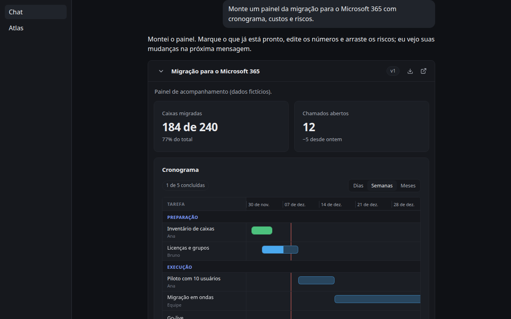
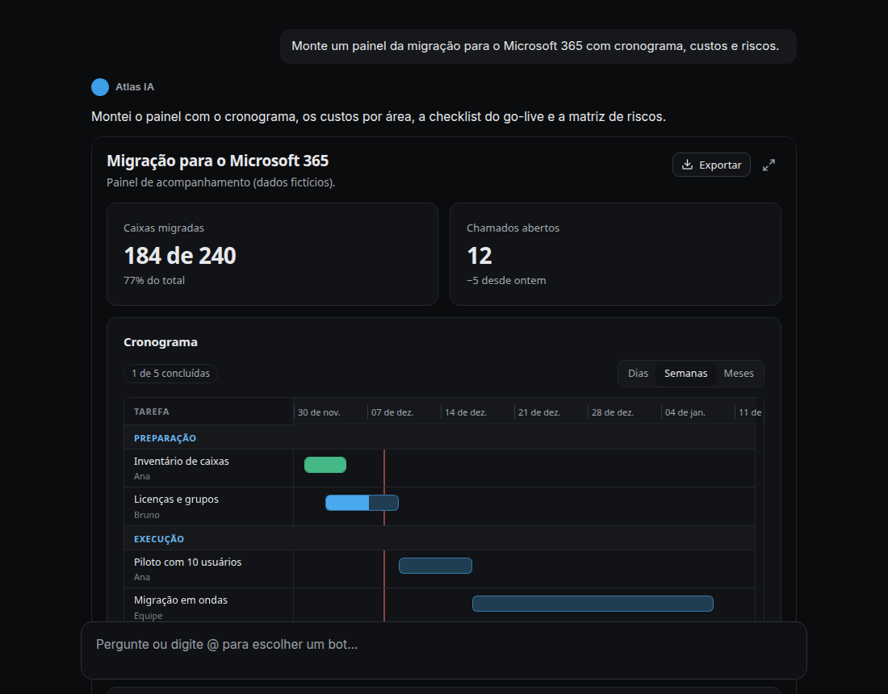
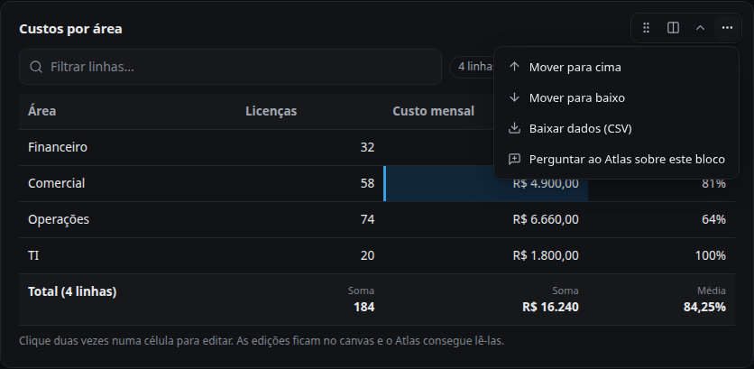
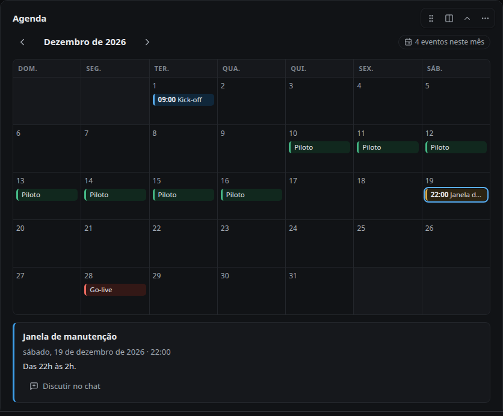
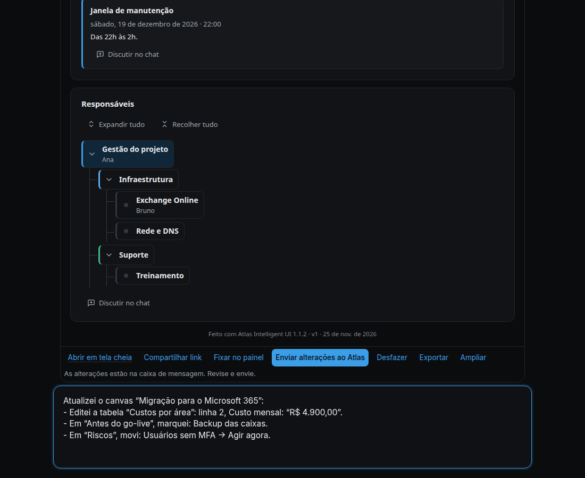
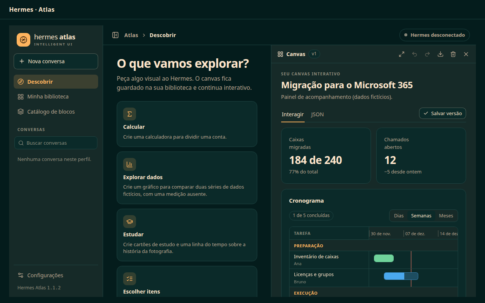

# Atlas Intelligent UI

[](https://github.com/sesantanajr/hermes-atlas-intelligent-ui/actions/workflows/ci.yml)


[English](README.en.md)

**Canvases interativos para o [Hermes Agent](https://github.com/NousResearch/hermes-agent).** Peça
um painel, um cronograma, uma comparação ou um orçamento, e o agente responde com um canvas que
você marca, edita, reorganiza, filtra e exporta: dentro da conversa no Hermes Desktop, no Webapp,
numa aba do dashboard, em qualquer app de chat que enquadre a página do canvas (como o portal
Atlas) ou como uma página HTML. Na mensagem seguinte, o agente já sabe o que você mudou.



**Versão 1.1.2**: canvas vivo em qualquer conversa que o enquadre, tabela editável, blocos que se
arrastam, exportação em PNG, PDF, CSV e HTML, quatro blocos de planejamento (cronograma, calendário,
matriz de prioridades e árvore), tema Atlas claro e escuro, e o Hermes Desktop e o Webapp voltando a
mostrar canvases em todos os perfis do Hermes 0.23. [O que mudou](CHANGELOG.md)

## Destaques

- **77 tipos de bloco** em nove categorias: gráficos, tabelas editáveis, formulários, checklists,
  mapas, rotas, kanban, cronogramas (Gantt), calendários, matrizes de prioridade, organogramas,
  calculadoras, quizzes, flashcards, orçamentos e mais. Tudo é JSON declarativo validado: o modelo
  não escreve HTML nem JavaScript.
- **Um canvas que se mexe.** Arraste blocos para reordenar, deixe-os em meia largura ou largura
  total, recolha o que não interessa, edite células de tabela com clique duplo e veja os totais
  recalculados. Tudo pelo teclado também.
- **Ida e volta com o agente.** O que você faz vira estado do canvas: o agente lê com `atlas_get`,
  e o Hermes o avisa, uma única vez, quando você mexe num canvas que ele criou. Em apps de chat que
  enquadram o canvas, **Enviar alterações ao Atlas** escreve um resumo na sua caixa de mensagem
  (nunca envia sozinho).
- **Exporta em qualquer lugar:** PNG, PDF em páginas A4, CSV (para Excel, com acentos), a página
  interativa com as suas alterações, JSON e Markdown. Sem rede e sem bibliotecas externas, até
  dentro de um quadro isolado.
- **Nativo em cada superfície:** canvas vivo na conversa do Desktop e do Webapp, aba no dashboard,
  quadro vivo em apps de chat, resumo em texto no terminal e nos apps de mensagem, e a página
  interativa como anexo quando você pedir.
- **Bonito e acessível:** tema Atlas claro e escuro (ou o tema do Hermes, quando dentro dele),
  movimento suave que respeita "reduzir movimento", foco visível, anúncios para leitores de tela e
  layout que se adapta a telas estreitas.
- **Leve e seguro:** nenhuma dependência Python ou Node para instalar; ações de um canvas só
  preparam mensagens que você revisa; a página exportada não acessa a rede. [Detalhes](docs/SECURITY.md)
- **Português e inglês**, seguindo o idioma do Hermes.

## Instalar

Requer **Hermes Agent 0.21.0** ou mais recente (0.23 ou mais recente para o canvas no Desktop e no
Webapp em todos os perfis). Não é preciso Node nem pacotes Python extras: os bundles da interface
já vêm no repositório.

```sh
hermes plugins install sesantanajr/hermes-atlas-intelligent-ui --enable
```

Sem `--enable`, o Hermes instala o plugin desligado; ligue com
`hermes plugins enable atlas-intelligent-ui`. Cada perfil do Hermes tem os seus plugins: para usar
o Atlas em outro perfil, instale e ligue nele também (`hermes -p <perfil> plugins install …`).

- **Hermes Desktop e Webapp**: em **Capacidades → Plugins**, o Atlas Intelligent UI ocupa uma
  linha com duas chaves. **Agente** liga as ferramentas, o comando `/atlas` e a skill; **Desktop**
  liga o canvas na conversa e a página **Atlas** na barra lateral. A chave **Desktop** vem
  desligada depois de uma instalação pelo terminal: ligue as duas.
- **Dashboard web**: a aba **Atlas** aparece ao recarregar o dashboard. Ela usa a biblioteca do
  perfil com que o dashboard foi iniciado (o Hermes 0.23 não serve rotas de plugins da comunidade
  nos outros perfis); nos outros perfis, use o Desktop ou o Webapp.
- **Lista explícita de toolsets**: se a sua configuração usa uma, inclua `atlas`
  (`hermes tools enable atlas --platform cli`). `hermes atlas doctor` aponta as plataformas sem ele.

Conferir, atualizar e remover:

```sh
hermes plugins doctor atlas-intelligent-ui
hermes atlas doctor
hermes plugins update atlas-intelligent-ui
hermes plugins remove atlas-intelligent-ui   # a biblioteca em plugin-data/atlas-intelligent-ui é mantida
```

Vindo da 1.0 (`hermes-atlas`)? Veja [Migração](docs/MIGRATION.md#da-10-para-a-11): o Hermes recusa
atualizar uma instalação cujo nome mudou, então reinstale uma vez e rode `hermes atlas migrate`.

## Usar

Peça como pediria a uma pessoa:

- “Monte um painel da migração para o Microsoft 365 com cronograma, custos e riscos.”
- “Compare três notebooks de até R$ 6 mil num canvas, com uma tabela e uma nota para cada um.”
- “Organize minhas tarefas da semana numa matriz de urgência e importância.”
- “Crie um calendário de estudos para a prova AZ-104 e flashcards dos tópicos.”
- “Transforme este CSV num gráfico de linhas por mês.” (com o arquivo anexado)

A skill `atlas-intelligent-ui:canvas` ensina o agente a decidir quando um canvas ajuda, a escolher
os blocos e a atualizá-los. A forma de apresentar o canvas depende de onde você conversa:

| Onde você conversa | O que aparece |
| --- | --- |
| **Hermes Desktop / Webapp** com a extensão ligada | O canvas vivo dentro da resposta. Marque, edite, arraste e exporte ali mesmo; botões do canvas colocam o texto no seu campo de mensagem, nunca enviam sozinhos. |
| Hermes Desktop sem a extensão | Um cartão com a página interativa do canvas, que abre na pré-visualização. |
| **Apps de chat que enquadram o canvas** (portal Atlas e outros clientes do gateway) | A linha `::atlas{…}` vira um quadro com a página do canvas, que se ajusta à altura, segue o tema do app, guarda o que você fez e manda as alterações para a caixa de mensagem. Veja o [protocolo do quadro](docs/ARCHITECTURE.md#o-canvas-enquadrado-por-outro-app). |
| **Dashboard web** | A aba **Atlas**: biblioteca, catálogo de blocos e uma conversa própria com o Hermes. |
| Terminal (CLI e TUI) | Um resumo em texto. `/atlas show <id>` mostra o canvas inteiro em Markdown. |
| Telegram, Discord, WhatsApp e outros | Um resumo em texto. Peça “me mande o canvas” e o agente anexa a página HTML, que abre no navegador do celular. |



### Mexer no canvas

| | |
| --- | --- |
|  |  |
| **Tabela editável**: clique duplo numa célula, totais por coluna, restaurar o original e CSV. Cada bloco tem alça de arrastar, largura, recolher e um menu com mover, CSV e “perguntar ao Atlas”. | **Matriz de prioridades**: arraste os cartões entre os quadrantes (ou use as setas). O agente lê onde cada cartão ficou. |
|  |  |
| **Calendário**: navegue pelos meses e abra um evento; em telas estreitas vira agenda. | **Enviar alterações ao Atlas**: num app de chat, o resumo do que você fez vai para a caixa de mensagem para você revisar e enviar. |

O canvas também segue o tema claro do app:


### Comandos

Em qualquer conversa:

```text
/atlas                                  resumo e canvases recentes
/atlas list [texto]                     buscar por título
/atlas show <id ou título> [versão]     ver o canvas em texto
/atlas export <id ou título> [html|md|json]
```

No terminal: `hermes atlas status`, `list`, `show`, `export`, `doctor`, `migrate` e `serve`. Este
último abre o Atlas como aplicativo independente em `http://127.0.0.1:7331`, sem login próprio e
só em loopback; ele lê a chave do servidor de API do Hermes no `.env` do perfil, então também roda
como serviço (veja [Desenvolvimento](docs/DEVELOPMENT.md#app-independente-como-serviço)).



## Configurar

```sh
hermes plugins config atlas-intelligent-ui
```

Todas as opções vêm ligadas no modo mais útil:

| Opção | Padrão | O que faz |
| --- | --- | --- |
| `reply_style` | `auto` | Como o canvas entra na resposta. `auto` escolhe pela superfície e pelo app que enviou a mensagem (tabela acima); `file` sempre anexa a página interativa; `directive` sempre usa a linha `::atlas{…}`; `text` nunca mostra o canvas na conversa. |
| `context_hints` | `true` | Avisa o agente, uma vez, quando você muda um canvas que ele criou. |
| `resources_tool` | `true` | Oferece `atlas_resources` (disco, memória e carga da máquina do Hermes). |
| `locale` | `auto` | Idioma de `/atlas`, `hermes atlas` e das exportações: `auto` (o do Hermes), `pt-BR` ou `en`. |

O chat próprio do Atlas (dashboard e aplicativo independente) usa o servidor de API do Hermes.
Habilite-o no perfil com `API_SERVER_ENABLED=true` e `API_SERVER_KEY`; o endereço padrão é
`http://127.0.0.1:8642/v1`, e perfis secundários usam `/p/<perfil>/v1`. Canvases, biblioteca,
ferramentas e o canvas na conversa funcionam sem ele.

## Ferramentas do agente

| Ferramenta | Para quê |
| --- | --- |
| `atlas_components` | Lista os 77 tipos de bloco ou devolve o schema e um exemplo de cada tipo pedido. |
| `atlas_render` | Cria um canvas, valida e salva na biblioteca; diz ao modelo como mostrá-lo naquela superfície. |
| `atlas_update` | Muda partes de um canvas (acrescentar, trocar, remover, mover blocos, título, fontes, estado). |
| `atlas_get` | Lê um canvas com o estado atual do usuário (marcações, respostas, células editadas, ordem e layout), inteiro, em esboço ou em texto. |
| `atlas_list` | Busca na biblioteca por título. |
| `atlas_export` | Grava o canvas em HTML interativo, Markdown ou JSON e devolve a linha `MEDIA:` para anexar. |
| `atlas_resources` | Mede disco, memória, swap e carga da máquina do Hermes, só leitura. |

Parâmetros, resultados e exemplos: [docs/TOOLS.md](docs/TOOLS.md).

## Seus dados

Tudo fica em `<HERMES_HOME>/plugin-data/atlas-intelligent-ui/`: a biblioteca (`atlas.db`, SQLite,
com cada versão de cada canvas, conversas do chat do Atlas e rascunhos) e as exportações
(`exports/`, as 60 mais recentes). Cada perfil do Hermes tem a sua, acessível só pelo seu usuário.
Nada é enviado a terceiros: o Atlas só fala com o próprio Hermes. Num app de chat que enquadra o
canvas, o que você fez fica guardado pelo próprio app (o portal Atlas usa o armazenamento do seu
navegador). Faça backup da pasta do plugin como faria com o resto do perfil.

## Documentação

- [Arquitetura](docs/ARCHITECTURE.md): como as peças se encaixam no Hermes, e o protocolo do quadro.
- [Compatibilidade](docs/COMPATIBILITY.md): o que o Atlas usa do Hermes, desde qual versão e como foi verificado.
- [Ferramentas](docs/TOOLS.md) · [Segurança](docs/SECURITY.md) · [Migrar da 1.0 e da 0.6](docs/MIGRATION.md)
- [Desenvolvimento](docs/DEVELOPMENT.md): compilar, testar e ver os hosts no navegador.
- [Histórico de versões](CHANGELOG.md)

## Licença

[MIT](LICENSE) © 2026 sesantanajr. Hermes Agent é um projeto da Nous Research; o Atlas é um
plugin da comunidade, sem vínculo oficial.
