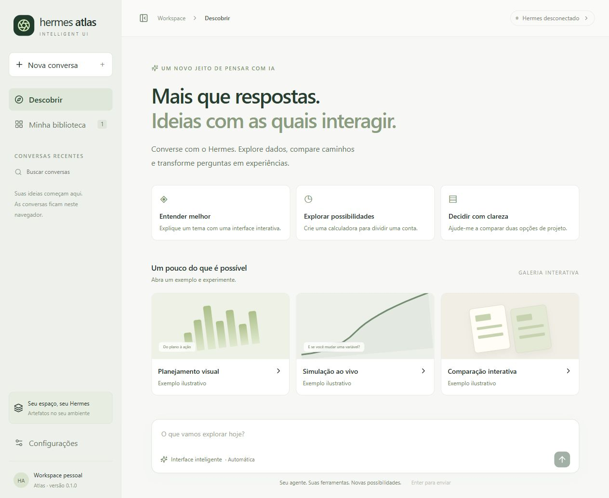

# Hermes Atlas · Intelligent UI

Uma interface visual e interativa para trabalhar com o **Hermes Agent**. Converse, explore um canvas, ajuste uma simulação e salve versões — mantendo o agente e suas ferramentas no seu ambiente.

**Versão 0.1.0 — alpha funcional.** Implementação independente, inspirada na Interface Inteligente do ChatGPT e no conceito de UI generativa do OpenUI. Não é um produto da OpenAI, Nous Research ou Thesys. Não há alegação de superioridade de desempenho ou paridade completa com esses produtos.



## O que já funciona

- Aplicativo React + TypeScript com chat, histórico local pesquisável, biblioteca e exportação JSON.
- Plugin nativo Hermes com `atlas_render` e `atlas_list`.
- Aba **Atlas** no dashboard, usando o React e o cliente autenticado fornecidos pelo host.
- Sete tipos de componentes: texto, indicadores, gráficos de barras, tabelas filtráveis/ordenáveis, checklists, comparações e calculadoras.
- Calculadoras com soma, produto, divisão e juros compostos; sem `eval`.
- Esquema Pydantic estrito, limites de tamanho, IDs únicos e validação antes de persistir.
- SQLite com revisões imutáveis e transações para gravações concorrentes.
- Galeria ilustrativa disponível mesmo sem gateway. O modo offline **não simula respostas da IA**.
- API oficial do Hermes como backend; credenciais somente no servidor.

## Instalar como plugin do Hermes

Requer uma versão do Hermes que ofereça plugins nativos, extensões do dashboard e API Server. Interfaces consultadas no commit `242315ce571cde721e717a544cf8ae6c343315cf` do Hermes em 21/11/2026. Não presumimos compatibilidade com todas as versões anteriores.

```sh
hermes plugins install sesantanajr/hermes-atlas-intelligent-ui
hermes plugins enable hermes-atlas
hermes plugins doctor hermes-atlas
hermes dashboard
```

O bundle do dashboard já está em `dashboard/dist/`; usuários do plugin não precisam de Node para compilá-lo. Reinicie o gateway/dashboard após instalar. Se houver uma seleção explícita de ferramentas em `hermes tools`, habilite o toolset `atlas`.

Peça ao agente: **“Use atlas_render para montar um canvas comparando estas duas opções…”**. Abra a aba **Atlas → Minha biblioteca** para visualizar o resultado. O plugin não substitui o chat nativo do Hermes.

Para conversar diretamente dentro da aba Atlas, também configure a API Server descrita abaixo. A autenticação do dashboard protege suas rotas; a chave da API do gateway é uma credencial separada e deve estar no ambiente do processo do dashboard.

## Executar o aplicativo local

Requisitos: Python 3.11+, Node 22+ e npm. Os comandos abaixo partem de um checkout deste repositório; distribuição por wheel independente ainda não inclui os arquivos web.

```sh
git clone https://github.com/sesantanajr/hermes-atlas-intelligent-ui.git
cd hermes-atlas-intelligent-ui
npm ci
npm run build
uv venv
```

Windows PowerShell:

```powershell
uv pip install --python .venv/Scripts/python.exe -e '.[test]'
$env:ATLAS_HERMES_URL = 'http://127.0.0.1:8642/v1'
$env:ATLAS_HERMES_API_KEY = '<a mesma API_SERVER_KEY do Hermes>'
# Se seu Hermes usa um perfil/diretório diferente, indique-o:
# $env:HERMES_HOME = 'C:/caminho/do/perfil-hermes'
./scripts/start.ps1
```

Linux/macOS:

```sh
uv pip install --python .venv/bin/python -e '.[test]'
export ATLAS_HERMES_URL=http://127.0.0.1:8642/v1
export ATLAS_HERMES_API_KEY='<a mesma API_SERVER_KEY do Hermes>'
sh scripts/start.sh
```

Abra **http://127.0.0.1:7331**. Sem API configurada, a galeria, a biblioteca e as calculadoras continuam disponíveis.

No ambiente do **Hermes**, habilite `API_SERVER_ENABLED=true`, defina uma `API_SERVER_KEY` forte e inicie `hermes gateway`. O endpoint padrão é `http://127.0.0.1:8642/v1`. O Atlas encaminha o histórico para `/chat/completions` com `model: hermes-agent`; o próprio Hermes resolve o modelo configurado.

`.env.example` documenta as variáveis, mas **não é carregado automaticamente**. Configure o ambiente do processo. Nunca coloque uma chave no frontend ou no Git.

## Como funciona

```text
Conversa → Atlas API → Hermes API Server → agente + ferramentas
                                ↓
                  texto + bloco JSON atlas
                                ↓
                  validação → SQLite → canvas React

Hermes CLI / outras interfaces → atlas_render → SQLite → biblioteca Atlas
```

O chat pede JSON tipado em um bloco `atlas`. Respostas sem canvas permanecem texto. JSON inválido fica como texto com aviso, sem executar ou renderizar código. A ferramenta nativa `atlas_render` usa o mesmo esquema e armazenamento.

As revisões são organizadas por `canvas.id`; reutilize o ID para atualizar. A biblioteca lista os 100 canvases atualizados mais recentemente. Checklists, seleção de comparação e posições dos controles são **estado temporário de exploração**: salvar uma versão grava a definição original do canvas, não esses ajustes locais.

Armazenamento padrão: `<HERMES_HOME>/plugin-data/hermes-atlas/atlas.db`. Dentro do Hermes, utiliza `plugin_data_dir()` quando disponível. No aplicativo independente, o fallback é `~/.hermes`; configure `HERMES_HOME` para corresponder ao perfil usado no gateway. `ATLAS_DATA_DIR` permite um diretório explícito. Conversas ficam no `localStorage` deste navegador (até 40 conversas); exporte-as antes de limpar dados do navegador.

## Desenvolvimento e testes

```sh
npm test
npm run build
npm audit
# Windows
.venv/Scripts/python.exe -m pytest -q
# Linux/macOS
.venv/bin/python -m pytest -q
```

Para desenvolvimento: inicie o backend e execute `npm run dev`. Vite encaminha `/api` ao backend. O harness `/tests/dashboard-harness.html` no servidor Vite testa o bundle IIFE com uma instância de React fornecida pelo host; não substitui o Plugin Doctor real.

Estrutura:

```text
plugin.yaml, __init__.py    registro nativo Hermes
atlas/models.py            protocolo validado
atlas/store.py             persistência e revisões
atlas/api.py               proxy e API de canvases
atlas/server.py            host local
dashboard/                 manifest, API e bundle distribuído
src/                       interface React compartilhada
tests/                     testes e harness do SDK
docs/                      arquitetura e validação
```

## Limites desta versão

- Respostas do chat são recebidas completas; streaming incremental, progresso detalhado de ferramentas e cancelamento remoto ainda não foram implementados.
- O protocolo é próprio, inspirado em UI generativa. **Não interpreta OpenUI Lang** e não incorpora o runtime do OpenUI.
- Não há colaboração multiusuário, anexos, voz, execução de HTML/JS gerado ou ações externas acionadas por componentes.
- O standalone é restrito ao loopback e ao uso pessoal. Para uso em rede, use o dashboard com sua autenticação normal. Não exponha o standalone por um proxy público.
- Não faz benchmark contra ChatGPT/OpenUI. Otimizações atuais: React compartilhado no plugin, ícones eliminados pelo bundler quando não usados, limites de payload e consultas indexadas por ID/revisão.
- A API do chat aceita até 50 mensagens por requisição; abra outra conversa ao atingir o limite. O timeout de 180 segundos encerra a espera HTTP, **não garante cancelamento do trabalho no Hermes**. Confira o gateway antes de repetir uma operação.

## Referências

- [Hermes: plugins](https://github.com/NousResearch/hermes-agent/blob/242315ce571cde721e717a544cf8ae6c343315cf/website/docs/user-guide/features/plugins.md)
- [Hermes: extensões do dashboard](https://github.com/NousResearch/hermes-agent/blob/242315ce571cde721e717a544cf8ae6c343315cf/website/docs/user-guide/features/extending-the-dashboard.md)
- [Hermes: API Server](https://github.com/NousResearch/hermes-agent/blob/242315ce571cde721e717a544cf8ae6c343315cf/website/docs/user-guide/features/api-server.md)
- [OpenUI](https://github.com/thesysdev/openui)
- [Interface Inteligente do ChatGPT](https://openai.com/pt-BR/index/gpt-6-for-everyone/)

Licença MIT. Veja [LICENSE](LICENSE).
