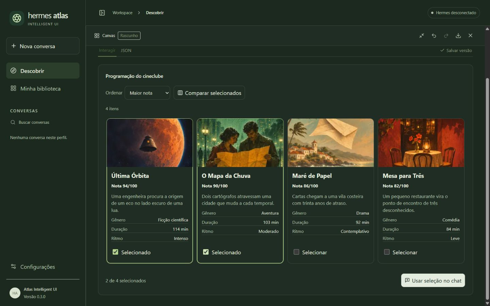

# Hermes Atlas · Intelligent UI

Interface conversacional e visual para o **Hermes Agent**, com canvases interativos, histórico persistente e execuções recuperáveis.

**Versão 0.3.0.** Plugin comunitário e independente para o Hermes Agent. Compare opções no próprio chat, leve a seleção ao agente e reabra o canvas com seus controles preservados. [O que mudou e como foi validado](docs/0.3.md)



## Recursos

- Chat com Markdown, resposta progressiva, progresso de ferramentas, cancelamento remoto e recuperação da mesma execução após reconectar.
- Histórico no servidor, busca, paginação, renomeação, exclusão da cópia Atlas e exportação JSON. Reutilização de mensagens pelo editor.
- Coleções de até 24 itens com ordenação por nota ou título, comparação de até quatro opções, fontes por item e uma ação que prepara a próxima mensagem. Para experimentar com dados fictícios, abra **Descobrir → Catálogo com seleção**.
- Canvases com texto, indicadores, barras positivas/negativas, tabelas, checklists, comparações, calculadoras e formulários. Blocos completos aparecem em prévia durante a geração.
- Estado dos controles preservado ao alternar visualizações, salvar, exportar e reabrir. Rascunho automático, desfazer/refazer e revisões imutáveis com proteção contra alterações concorrentes.
- Canvas ativo enviado como contexto, inclusive quando aberto pela biblioteca. Mensagens apontam para a revisão produzida naquela resposta.
- Até quatro anexos de texto/Markdown/CSV/JSON/log por mensagem, até 200 KB cada e 450 KB no pedido total.
- Formulários preparam uma mensagem revisável. Aprovações e esclarecimentos do agente usam os controles reais do Hermes.
- Temas claro, escuro e do sistema, canvas ampliável e alternância entre conversa e canvas em telas estreitas.
- Ferramentas nativas `atlas_render`, `atlas_list`, `atlas_get`; dashboard IIFE e Desktop ESM com React fornecido pelo host.
- Credenciais apenas no backend; armazenamento por perfil; verificação de capacidades antes de admitir execuções.

## Instalar no Hermes

```sh
hermes plugins install sesantanajr/hermes-atlas-intelligent-ui
hermes plugins enable hermes-atlas
hermes plugins doctor hermes-atlas --ci
```

No Desktop/Webapp, abra **Capacidades → Plugins → Verificar novamente** e habilite também a extensão **Hermes Atlas Intelligent UI**. A extensão visual e a parte do agente têm ativação independente no Hermes. Para Desktop local conectado a um gateway remoto, instale a parte Desktop também na máquina do Desktop usando **Instalar do Git**. Os bundles já estão no repositório; Node não é necessário para instalar o plugin.

No dashboard clássico, abra a aba **Atlas**. Se a versão do host não recarregar plugins automaticamente, reinicie esse host. Habilite o toolset `atlas` caso sua configuração use uma lista explícita de ferramentas.

Peça ao agente: “Use atlas_render para criar uma comparação interativa”. Abra **Atlas → Minha biblioteca**. Para revisar um canvas, o agente lê `atlas_get` e envia sua revisão como `expected_revision`; alterações antigas não sobrescrevem as novas.

## Conexão com o agente

O chat Atlas usa a **Runs API oficial**. No ambiente do Hermes habilite `API_SERVER_ENABLED=true`, configure `API_SERVER_KEY` e inicie o gateway. O padrão é `http://127.0.0.1:8642/v1`; perfis nativos usam a rota `/p/<perfil>/v1`. O Atlas utiliza o secret scope do perfil quando executado dentro do Hermes.

Para um endpoint explícito, configure no backend `ATLAS_HERMES_URL` e `ATLAS_HERMES_API_KEY`. Fora do loopback, o endpoint deve usar HTTPS. `.env.example` documenta as variáveis, mas não é carregado automaticamente. Nunca coloque chaves no frontend ou no Git.

O chat Atlas usa sessões persistentes da Runs API. Na extensão Desktop, **Enviar à sessão nativa** envia o texto do editor, o conteúdo dos anexos textuais e o canvas à sessão focada por `prompt.submit`. A resposta aparece no chat nativo. Trocar de perfil ou gateway invalida respostas pendentes da tela anterior.

## Aplicativo independente / wheel

O wheel inclui o aplicativo compilado e todo o plugin, sem depender do checkout:

```sh
pip install ./hermes_atlas_intelligent_ui-0.3.0-py3-none-any.whl
hermes-atlas serve
# Opcional: copiar o plugin para uma instalação Hermes nova
hermes-atlas install-plugin --home /caminho/do/hermes
```

Acesse `http://127.0.0.1:7331`. A cópia recusa substituir um plugin existente. Para atualização de instalação Git, use o gerenciador do Hermes.

Para desenvolver a partir do código (Python 3.11+, Node 22+):

```sh
npm ci
npm run build
python -m pip install -e '.[test]'
python -m atlas.cli serve
```

Use o Python do seu ambiente virtual. No PowerShell, configure variáveis com `$env:ATLAS_HERMES_URL = 'http://127.0.0.1:8642/v1'`; no Linux/macOS, use `export`. O standalone escuta apenas em loopback; para acesso remoto utilize o host autenticado do Hermes ou um túnel SSH.

## Dados e recuperação

O arquivo `<HERMES_HOME>/plugin-data/hermes-atlas/atlas.db` guarda conversas, execuções, revisões e o canvas de trabalho. `ATLAS_DATA_DIR` permite um diretório explícito no standalone. O texto e os anexos ainda no editor ficam na aba do navegador, separados por conversa e perfil. Para dados antigos em localStorage da v0.1, exporte o histórico antes da atualização.

Canvases existentes continuam legíveis; os novos campos de estado têm valores padrão. Faça backup do SQLite antes de atualizar. Excluir uma conversa na interface remove sua cópia Atlas; não apaga registros mantidos pelo Hermes ou pelo provedor.

Fechar a página não cancela o agente. O botão **Parar** solicita cancelamento remoto e aguarda o estado confirmado. Após falha de conexão, o Atlas recupera o ID existente. Se o Hermes declarar resultado desconhecido, a interface exige reconhecimento explícito; não inicia uma tarefa duplicada automaticamente.

## Verificar

```sh
npm test
npm run build
npm audit
python -m pytest -q
python scripts/benchmark.py --output docs/benchmark.json
python -m pip wheel --no-deps --wheel-dir work/wheels .
python scripts/verify-wheel.py work/wheels
# Opt-in: envia três pedidos sintéticos ao Hermes configurado e consome o provedor
python scripts/verify-live.py --base http://127.0.0.1:7331 --output work/live.json
```

[Arquitetura](docs/ARCHITECTURE.md) · [Validação e medidas](docs/VALIDATION.md) · [Escolha do renderer](docs/GENERATIVE-UI.md)

## Limites explícitos

Esta versão não implementa toda a superfície do Hermes nem paridade com ChatGPT/OpenUI. Não há voz, OCR/PDF/imagens como anexos, colaboração multiusuário, edição/fork do histórico nativo, importação OpenUI Lang/A2UI, HTML/JS arbitrário ou ações externas executadas diretamente por componentes. O modelo e suas ferramentas continuam sujeitos às capacidades e configurações do Hermes.

O backend consome eventos SSE. A tela consulta o estado a cada aproximadamente 450 ms enquanto visível e a cada 3 s quando oculta, inclusive pelo transporte JSON do host. A prévia exibe blocos já validados. Ao concluir, o Atlas valida o documento inteiro e habilita a edição. A galeria com dados de exemplo também funciona offline.

Compatibilidade real verificada em Hermes **0.23.2**, não em todas as versões. Os controles de aprovação, clarificação e resultado desconhecido têm testes de contrato; não provocamos operações perigosas para testar aprovações reais. Não há alegação de ausência de todos os bugs, auditoria externa ou superioridade medida sobre outros produtos.
