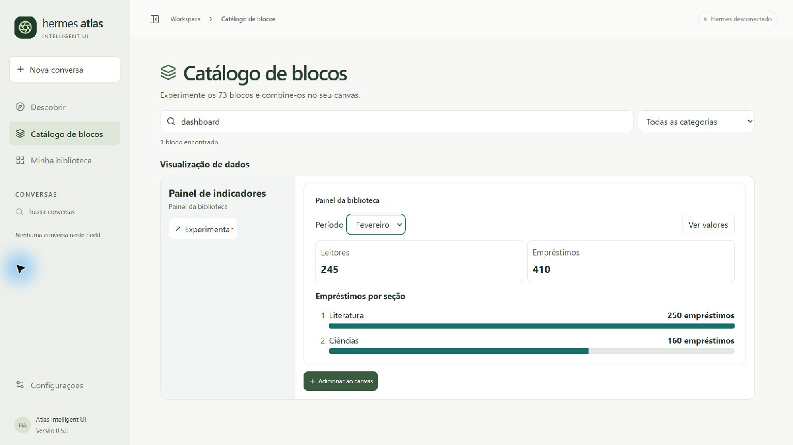

# Hermes Atlas 0.5 · Catálogo de blocos

O Atlas passou de 15 para **73 tipos de bloco**. Cada tipo tem identificador próprio no JSON, validação em Python, um componente de interface e um exemplo que pode ser aberto no catálogo. O limite continua em 32 blocos por canvas. As oito categorias abaixo agrupam os componentes pela tarefa que ajudam a realizar.

| Categoria | Tipos | Exemplos de uso |
| --- | ---: | --- |
| Texto e formatação | 9 | Organizar um artigo, destacar um aviso, compor uma fórmula ou listar fatos. |
| Layout e organização | 7 | Distribuir conteúdo em colunas, percorrer cartões em um carrossel, pesquisar uma tabela. |
| Formulários | 8 | Coletar um período, um número, uma escolha ou uma resposta longa, isoladamente ou em formulário. |
| Controles interativos | 10 | Registrar um voto pessoal, corrigir um quiz, marcar tarefas por grupo ou retomar um temporizador. |
| Visualização de dados | 18 | Investigar uma distribuição com histograma, comparar perfis com radar ou ler indicadores em painel. |
| Mídia e conteúdo visual | 5 | Ver fotografias e diagramas, percorrer uma galeria e reproduzir áudio ou vídeo com transcrição. |
| Informações conectadas | 10 | Explorar lugares e referências, comparar produtos e consultar variantes com preço e disponibilidade declarados. |
| Aplicações e documentos | 6 | Editar um texto, mover uma tarefa no Kanban, seguir uma árvore de decisão e simular um orçamento. |

## Experimentar uma resposta

1. Abra **Catálogo de blocos** na barra lateral. Pesquise **orçamento** e clique em **Experimentar**. Altere a quantidade de impressões e confira o total e o saldo.
2. Clique em **Adicionar ao canvas** para incluir o exemplo com as quantidades que você escolheu na prévia. Continue ajustando a simulação no seu canvas.
3. Volte ao catálogo e adicione **Tarefas por grupo**. Marque os itens preparados e observe o progresso. Salve uma revisão e reabra-a pela biblioteca para recuperar as quantidades e as marcações.

Para gerar outro conjunto, peça ao Hermes “Monte um canvas para uma viagem de quatro dias. Inclua um orçamento em reais, um seletor de período e três locais marcados no mapa. Identifique todos os valores de exemplo”. Os blocos compartilham um documento e cada um mantém seu próprio estado. Um seletor de datas opera sobre o seu campo. Filtrar vários gráficos pelo mesmo período exigiria uma ligação entre blocos.



## Consultar o contrato de um componente

A ferramenta nativa `atlas_components` e a API expõem um índice leve. O detalhe de um único tipo inclui um exemplo e o JSON Schema que o agente usa para preencher os campos. A rota base no standalone é `/api/plugins/hermes-atlas`.

| Operação | Ferramenta e argumentos | HTTP depois da rota base |
| --- | --- | --- |
| Listar componentes | `atlas_components {}` | `GET /components` |
| Pesquisar | `atlas_components {"q":"quiz"}` | `GET /components?q=quiz` |
| Obter definição e exemplo | `atlas_components {"type":"quiz"}` | `GET /components/quiz` |

Use o objeto `example` como um item de `canvas.blocks`. O `type` identifica o componente e o `id` identifica aquela instância dentro do canvas. Ao incluir duas instâncias do mesmo tipo, dê um ID diferente a cada uma. O estado fica associado a esse ID. Para atualizar pelo Hermes, consulte `atlas_get` e passe a revisão lida junto com o documento para `atlas_render`.

## Como o Atlas se compara

O anúncio da OpenAI demonstra respostas que viram interfaces, como explicações visuais e planejadores interativos. A análise da Thesys de **8 de outubro de 2026** encontrou cerca de 70 componentes no registro do cliente web e identificou 39 nas respostas que capturou. A estimativa é da Thesys. A OpenAI descreve as experiências sem fixar um total de componentes. Contagem, fluidez e qualidade das respostas são métricas diferentes. [Anúncio da OpenAI](https://openai.com/pt-BR/index/gpt-6-for-everyone/) · [Análise técnica da Thesys](https://www.openui.com/blog/how-chatgpt-intelligent-ui-works)

O OpenUI oferece linguagem para composição, renderização progressiva e bibliotecas extensíveis. O Atlas adota um catálogo tipado e oferece sua descoberta dentro do Hermes. O modelo produz JSON declarativo e os componentes implementam as interações. O frontend mostra blocos completos validados enquanto recebe a resposta e habilita a edição depois da validação do documento. O tempo até a primeira prévia depende de quando o modelo fecha o primeiro bloco. [Código e documentação do OpenUI](https://github.com/thesysdev/openui)

O uso de mídia remota depende de um clique para carregá-la. Os exemplos de preço, disponibilidade e lugares têm os dados declarados pelo autor. Votos refletem escolhas daquele canvas, o temporizador usa o relógio local e o editor prepara mensagens para revisão. Compras, colaboração simultânea, atualização automática de preços, execução de código de terceiros e importação de OpenUI Lang estão fora do escopo desta versão.

## Validação com Hermes Agent

Em 21 de novembro de 2026, uma instalação temporária do Atlas 0.5.0 passou pelo Plugin Doctor no Hermes Agent 0.23.2. O dispatcher executou `atlas_components`, `atlas_render`, `atlas_get` e `atlas_list`. Os 73 exemplos foram salvos em cinco lotes. O editor recuperou uma segunda revisão após reabrir o armazenamento, e a API recusou uma atualização baseada na revisão anterior com HTTP 409.

Em uma execução do gateway, um pedido em português produziu `glossary` e `document` com os termos e o trecho solicitados. A primeira prévia apareceu após 10,1 s e a resposta terminou após 11,2 s. O tempo corresponde a essa única execução, com o modelo e a carga daquele servidor.

Os bundles distribuídos de Dashboard e Desktop também foram montados em jsdom com React 19 e os contratos de host simulados. Ambos abriram o catálogo e aplicaram a busca e o controle deslizante. O Desktop registrou a rota e a navegação em `/atlas`. [SDK do Hermes Desktop](https://hermes-agent.nousresearch.com/docs/developer-guide/desktop-plugin-sdk)

O mapa usa os contornos terrestres de domínio público da Natural Earth em projeção equirretangular. Os pontos e o zoom funcionam localmente. O link de cada lugar abre a cartografia detalhada. [Base cartográfica Natural Earth](https://www.naturalearthdata.com/about/terms-of-use/)

## Reproduzir a verificação

Na raiz do checkout, com as dependências de desenvolvimento instaladas, execute os testes e a compilação. O teste de integração compara os tipos aceitos pelo backend aos exemplos do catálogo e percorre a renderização de cada tipo. Os testes de interface adicionais exercitam interações e a reabertura do estado.

```sh
python -m pytest -q
npm test
npm run build
python -m pip wheel --no-deps --wheel-dir work/wheels .
python scripts/verify-wheel.py work/wheels
```

O teste do wheel instala o pacote em um ambiente separado. O standalone permite testar a biblioteca e o catálogo localmente. Geração de novas respostas exige um gateway Hermes com Runs API configurada. [Instalação, gateway e variáveis de ambiente](../README.md)
