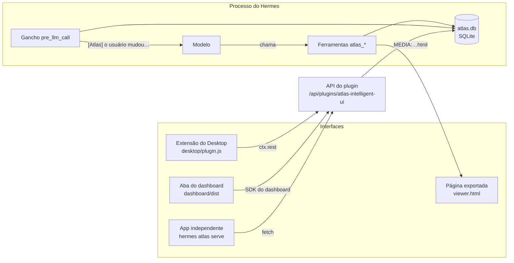

# Arquitetura do Atlas Intelligent UI 1.1.2

O Atlas é um **pacote unificado** do Hermes Agent: uma pasta com a metade do agente
(`plugin.yaml` + `__init__.py`), uma skill, a aba do dashboard (`dashboard/`) e a extensão do
Desktop (`desktop/plugin.js`). Uma única instalação liga tudo; cada metade tem sua chave em
**Capacidades → Plugins**.

## A pasta do plugin

| Caminho | O que é |
| --- | --- |
| `plugin.yaml` | Manifesto v2: ferramentas e gancho declarados, `config_schema`, `requires_hermes: ">=0.21.0"`. Nenhuma `python_dependencies`. |
| `__init__.py` | `register(ctx)`: delega para `hermes_atlas/agent/plugin.py` com import relativo, como o Hermes exige. |
| `skills/canvas/SKILL.md` | A skill `atlas-intelligent-ui:canvas`: quando usar um canvas, como montar, mostrar e atualizar. |
| `hermes_atlas/` | O pacote Python (abaixo). |
| `dashboard/manifest.json`, `dashboard/plugin_api.py`, `dashboard/dist/` | A aba **Atlas** do dashboard e as rotas `/api/plugins/atlas-intelligent-ui/…`, que servem também o Desktop. |
| `desktop/plugin.js` | A extensão do Desktop e do Webapp: um único módulo ES. |
| `src/` | O código TypeScript/React de todas as interfaces. Os bundles gerados ficam versionados, então instalar pelo Git não exige Node. |

### O pacote `hermes_atlas`

| Módulo | Responsabilidade |
| --- | --- |
| `schema/` | Os 77 tipos de bloco e o `Canvas`, em pydantic (os de planejamento em `schema/planning.py`). Só é importado quando um canvas é validado. |
| `catalog.py`, `catalog.json` | O catálogo (rótulos pt/en, categoria, resumo, exemplo) gerado de `src/blocks/catalogData.ts`. |
| `storage/` | `Store`: revisões imutáveis, rascunhos, vínculos canvas–sessão, conversas do chat do Atlas. Só biblioteca padrão (`sqlite3`). |
| `render/` | Canvas → Markdown (77 tipos, com e sem tabelas) e canvas → página HTML autossuficiente. |
| `agent/` | A integração com o agente: `plugin.py` (registro), `tool_schemas.py`, `tools.py`, `surfaces.py`, `hooks.py`, `rpc.py` (a API pelo RPC de plugins, 1.1.2), `commands.py` (`/atlas`), `cli.py` (`hermes atlas`), `settings.py`. |
| `server/` | A API HTTP (`api.py`), a reexecução dela para o RPC (`rpc.py`), o chat do Atlas pela Runs API (`runs.py`, `gateway.py`, `protocol.py`) e o app independente (`app.py`). |
| `runtime.py` | Onde ficam os dados, qual perfil e qual gateway, lidos do jeito do Hermes (`get_hermes_home`, secret scope, `plugin_data_dir`). |
| `doctor.py` | O diagnóstico de `hermes atlas doctor`, só leitura. |

## Custo na inicialização

O Hermes importa todo plugin habilitado ao iniciar cada processo (CLI, gateway, dashboard).
`register()` importa apenas a biblioteca padrão e módulos leves do próprio Atlas: pydantic,
FastAPI e httpx ficam para a primeira chamada de ferramenta ou de rota. Medido com
`scripts/benchmark.py` num processo que já tem a biblioteca padrão carregada: cerca de 19 ms, sem
nenhuma dessas bibliotecas importada. A 0.6 levava cerca de 650 ms e carregava FastAPI, Starlette,
httpx e pydantic em todo processo, inclusive nos que nunca usariam o Atlas.

## Como um canvas chega ao usuário

`atlas_render` e `atlas_update` validam o canvas, gravam uma revisão e respondem ao modelo com
`show` e `present`, a instrução de como mostrá-lo **naquela** superfície
(`agent/surfaces.py`):

| `show` | Quando | O que o modelo escreve |
| --- | --- | --- |
| `file` | Desktop/Webapp com a extensão num Desktop que tem *tool media renderers*, ou Desktop sem a extensão. | A linha `MEDIA:<caminho>.html` no fim da resposta. A extensão troca o cartão do arquivo pelo canvas vivo; sem a extensão, o Desktop mostra o cartão com pré-visualização da página. |
| `directive` | Extensão num Desktop que tem diretivas de transcrição, mas não *tool media renderers*; sempre no chat do próprio Atlas; e, desde a 1.1.2, numa sessão `desktop` cujo turno veio de outro app que não o Hermes Desktop ou o Webapp (o portal Atlas). | A linha `::atlas{id="…" rev="…"}` como parágrafo próprio. |
| `text` | Terminal, apps de mensagem, outros clientes da API. | Um resumo em texto; `atlas_export` envia a página se o usuário pedir. |
| `either` | Superfície desconhecida (Hermes antigo). | `present` explica as duas opções. |

A superfície vem de `ctx.session_surface()` (ou de `HERMES_SESSION_PLATFORM` em versões
anteriores). No Hermes 0.23 toda sessão local aberta com `source: gui` responde `desktop`, seja o
Hermes Desktop, seja outro app; por isso a 1.1.2 lê também `ctx.turn_client()`, o cliente que
enviou o turno: `hermes-desktop` e `hermes-webapp` recebem o arquivo; um turno sem cliente
anunciado, ou de outro app, recebe a diretiva. O que o Desktop consegue desenhar vem de um aperto de mão: ao carregar, a extensão
chama `POST /clients/desktop` com `features: ["directive", "tool_media"]`, conforme o que o SDK
daquele Desktop exporta. A opção `reply_style` força um dos modos.

A linha `MEDIA:` é o caminho que a documentação do Desktop recomenda para plugins com ferramentas
próprias: toda superfície do Hermes entende `MEDIA:`, e o Desktop só deixa o plugin dono da
ferramenta trocar o cartão do arquivo (`TOOL_MEDIA_RENDERER_AREA`, ferramentas `atlas_render` e
`atlas_update`). A diretiva continua para Desktops anteriores a essa área.

## A volta: o que o usuário fez

1. No canvas embutido (`src/host/InlineCanvas.tsx`), cada interação é salva, depois de 700 ms sem
   mudanças, como **rascunho** da revisão exibida (`PUT /canvases/{id}/draft`), com um token de
   concorrência. Nenhuma revisão nova é criada até o usuário pedir **Salvar versão**.
2. `atlas_get` devolve o rascunho como `unsaved_user_changes` e o estado de cada bloco (itens
   marcados, respostas de formulário, seleções, texto editado).
3. No turno seguinte, o gancho `pre_llm_call` acrescenta, uma única vez, a nota
   `[Atlas] The user changed canvases you created…` para os canvases daquela sessão. O gancho não
   cria arquivos: sem biblioteca, ele não faz nada.
4. Para mudar o canvas, o modelo chama `atlas_update` com `expected_revision`. Uma revisão
   desatualizada é recusada com a orientação de ler de novo.

Quando a revisão muda, o backend avisa as interfaces (`broadcast_plugin_event` →
`plugin.atlas-intelligent-ui.canvas.saved`) e os canvases abertos se atualizam sem consultas periódicas.

## Interfaces

Um único código React, quatro compilações (`scripts/build.mjs` e Vite):

| Alvo | Arquivo | Particularidades |
| --- | --- | --- |
| Aba do dashboard | `dashboard/dist/index.js` + `index.css` | Script clássico registrado em `window.__HERMES_PLUGINS__`. Usa o React do dashboard (via `__HERMES_PLUGIN_SDK__`) e `authedFetch`. Segue `useI18n()`. |
| Extensão do Desktop | `desktop/plugin.js` | Módulo ES que importa só `react`, `react/jsx-runtime` e `@hermes/plugin-sdk` (por namespace, com detecção de recursos). CSS embutido, removido ao descarregar. Registra a página `/atlas`, o item da barra lateral, o renderizador de mídia e a diretiva. Desde a 1.1.2 fala com o plugin primeiro pelo RPC `plugin.atlas-intelligent-ui.http` (`host.request`), que o gateway executa no perfil dono, e só depois por `ctx.rest`. |
| App independente | `hermes_atlas/static/` | Vite. Servido por `hermes atlas serve` em `127.0.0.1:7331`. |
| Página exportada | `hermes_atlas/assets/viewer.html` | Um arquivo com o canvas embutido; CSP fixa o script por hash e proíbe rede. É também a página que um app de chat enquadra (protocolo do quadro, abaixo). |

`scripts/check-bundles.mjs` aplica, a cada compilação, as regras que o Hermes impõe: imports
permitidos e ausência de `eval`, `import()` dinâmico, injeção de `<script>` e acesso ao DOM do
aplicativo no `plugin.js` (a mesma análise do `hermes plugins validate`); nenhum React próprio
nos bundles; arquivos abaixo de 1 MiB (limite da varredura de instalação); versões coerentes.

**Tema.** As cores vêm de tokens (`src/theme/tokens.css`). Dentro do Hermes, os tokens apontam
para as variáveis do tema do host (`--color-card`, `--ui-bg-card`…), então qualquer tema do
Hermes, inclusive personalizado, se aplica. Claro ou escuro é medido do fundo realmente pintado
atrás do Atlas, para escolher cores de gráfico com contraste.

**Idioma.** O texto da interface é escrito em português e traduzido para inglês
(`src/i18n/`): `t("Salvar versão")`. Testes garantem que todo texto tem tradução e que nenhuma
tradução sobra. O idioma segue, nesta ordem: a escolha feita nas configurações do Atlas; a
opção `locale` do plugin ou o `display.language` do Hermes; o idioma da página do host.

**Altura.** Embutido, o Atlas ocupa do seu topo até o fim da caixa que tem altura própria (o
painel do Desktop) ou da janela, descontando o espaçamento do host. Caixas que crescem com o
conteúdo, como a seção de uma página do dashboard, não limitam a altura.

## O chat do próprio Atlas

O dashboard e o app independente têm uma conversa própria que usa a **Runs API** do Hermes
(`/v1/runs`), com execuções duráveis: chave de idempotência por pedido, recuperação da mesma
execução depois de uma queda, cancelamento confirmado e controles de aprovação e esclarecimento.
Nessa conversa, o servidor do Atlas resolve as linhas `::atlas{…}` da resposta e mostra o canvas
ao lado. Na extensão do Desktop, a conversa é a do próprio Desktop.

## Dados

`<HERMES_HOME>/plugin-data/atlas-intelligent-ui/atlas.db`, um SQLite por perfil:

- `owned_canvases`: cada revisão de cada canvas, imutável, limitada a 256 KB.
- `documents`: rascunhos (`canvas_draft`), vínculos canvas–sessão (`canvas_link`), o que cada
  interface consegue desenhar (`client`), conversas e execuções do chat do Atlas.
- O espaço de trabalho é identificado pelo perfil e pelo gateway; perfis diferentes não
  compartilham bibliotecas, mesmo com `ATLAS_DATA_DIR` em comum.

As exportações ficam em `exports/` (as 60 mais recentes, cerca de 0,8 MB cada página HTML).

## O canvas enquadrado por outro app

Um app de chat que não é o Hermes Desktop (o portal Atlas, por exemplo) mostra um canvas trocando a
linha `::atlas{id rev}` por um `<iframe sandbox="allow-scripts allow-downloads">` com a página
exportada (`viewer.html` com a revisão embutida). Sem `allow-same-origin`, a página não alcança
cookies, armazenamento nem o DOM do app. Desde a 1.1.2 os dois lados conversam por `postMessage`
(`src/host/embed.ts`):

| Direção | Mensagem | Para quê |
| --- | --- | --- |
| canvas → app | `ready {id, revision, title, atlas}` | A página está desenhada e escutando. |
| canvas → app | `height {height}` | A altura de que precisa: o app ajusta o quadro e não sobra barra de rolagem. |
| canvas → app | `state {canvas, changes, changed}` | O que a pessoa fez (estado, células, ordem, largura) e um resumo legível; o app guarda e oferece "Enviar alterações". |
| canvas → app | `action {text}` | Texto de um botão "perguntar no chat" para a caixa de mensagem; nunca enviado sozinho. |
| canvas → app | `fullscreen {}` | A pessoa pediu para ampliar. |
| app → canvas | `hello {theme, state, locale}` | Tema claro ou escuro do app e o estado guardado da última vez. |
| app → canvas | `theme {theme}` | O app trocou de tema. |
| app → canvas | `export {format}` | `png`, `pdf`, `csv`, `html` ou `json`, feitos dentro da página. |
| app → canvas | `reset {}` | Volta ao canvas como o agente escreveu. |

Toda mensagem leva `source` (`atlas-canvas` ou `atlas-host`) e `version: 1`. A página só lê
mensagens da janela que a enquadra (`event.source === window.parent`); um estado devolvido pelo app
só muda o que a pessoa poderia mudar à mão (estado de interação dos blocos conhecidos, a ordem
quando ela tem exatamente os mesmos blocos e os valores de calculadoras dentro dos limites): o
conteúdo dos blocos vem sempre da própria página. Uma página de uma versão anterior simplesmente não
fala o protocolo, e o app a mostra como antes. O lado do app no portal Atlas é
`atlas-canvas-1273.js` (repositório do portal).

## Reorganizar, editar e exportar (1.1.2)

- **Layout**: cada bloco de um canvas editável ganha controles (`src/blocks/BlockChrome.tsx`):
  alça de arrastar (as setas movem pelo teclado), meia largura ou largura total, recolher e um menu.
  A ordem fica na lista `blocks`; `width` e `collapsed` no estado do bloco.
- **Tabela**: células editadas ficam em `state.cells` (`"<linha>:<coluna>"` sobre as linhas
  originais), então ordenar e filtrar continuam valendo e o agente vê o que mudou. Totais saem de
  `src/blocks/tabular.ts`, que também dá a leitura em tabela de cada bloco para o CSV.
- **Exportação** (`src/blocks/exporters.ts`): PNG é o canvas desenhado por um `foreignObject` SVG
  num `<canvas>`; PDF embrulha fatias JPEG desse desenho em páginas A4, sem biblioteca. As duas
  funcionam no quadro isolado, onde imprimir não é permitido.
